# Add Khmer typing to the iOS Full keyboard

## What are you trying to do?

I’d like to write a Khmer message, switch to English for a name, and switch back to Khmer without leaving Hex’s Full keyboard on my iPhone. Adding Khmer to the language picker would let me do that with Hex’s existing Space-bar gesture and keep dictation within reach.

## What would help?

Please add **ភាសាខ្មែរ (Khmer)** under **Settings › Keyboard › Languages**. I’d like the familiar iPhone-style layout as the default, with **Khmerism** as a second choice under **Layout**.

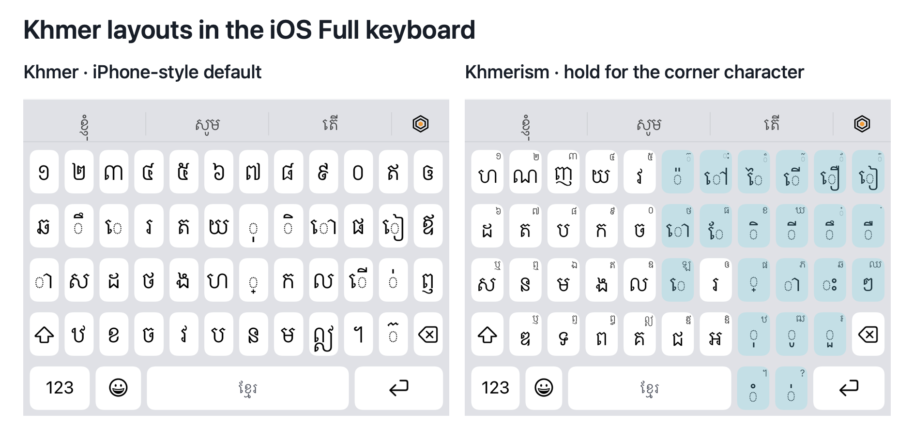

On **Khmerism**, tap for the large character or hold for the one in the corner. For example, the top-left key types **ហ** on tap and **១** on hold. Shift swaps them. The key turns rose when the digit becomes the tap character. Teal marks combining vowels and signs and some Khmer punctuation, green marks independent vowels, and rose marks Khmer digits. I’d like to be able to hide the colors or the corner labels independently.

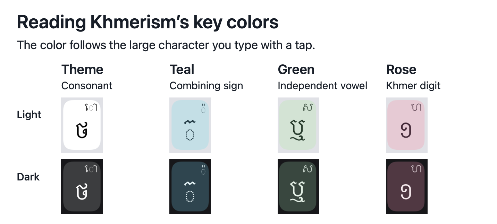

I’d like both layouts to support these everyday typing tasks.

- **Type a subscript.** To write **ស្ថ**, type **ស** and the coeng sign **្**. On the iPhone-style layout, tap **ថ** in its usual place. On Khmerism, the key that normally types **◌ោ** now offers **ថ** on tap. After that tap, the vowel returns.
- **Write a phrase without adding spaces between words.** On either layout, tapping **សូម**, then **អរគុណ**, then **ច្រើន** should write **សូមអរគុណច្រើន**. I’d like these next-word suggestions and completions from the first letter to work offline, including when Autocorrect is off.

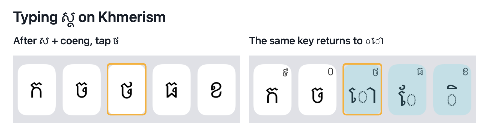

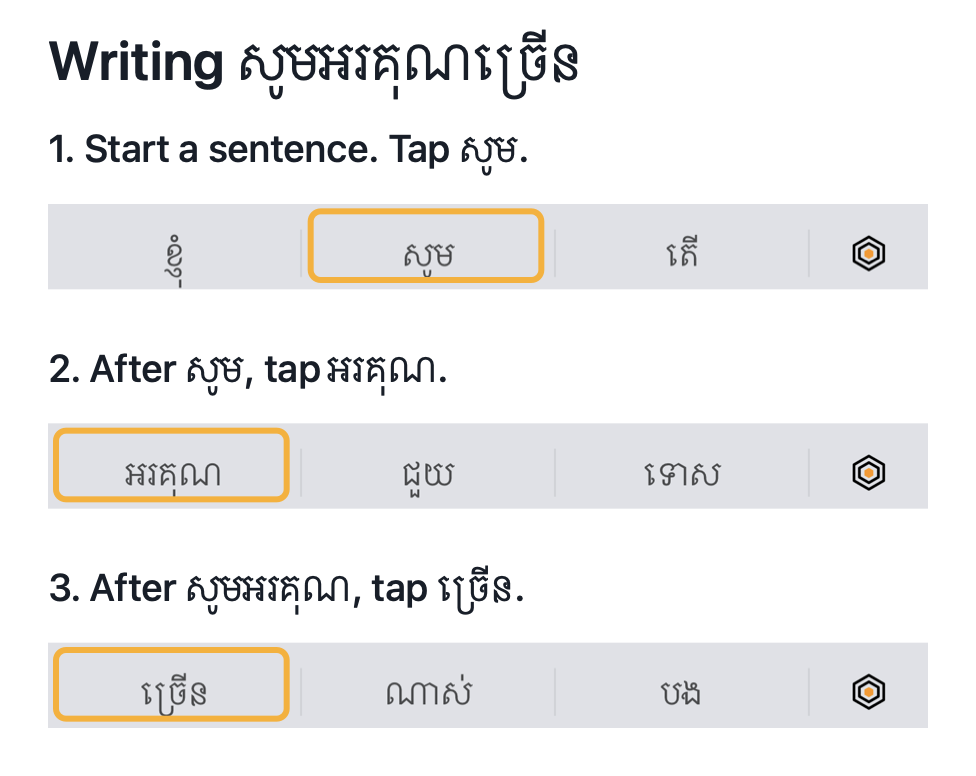

Both layouts should use Hex’s existing **Autocorrect** and **Swipe typing** switches. With Autocorrect on, tapping **ញ** and **◌ំ** in an ordinary text field should produce **ខ្ញុំ**. With it off, I’d expect the literal **ញំ**. When swiping, I’d like consecutive Khmer words to join without an automatic space.

Choosing a layout and reading the keys

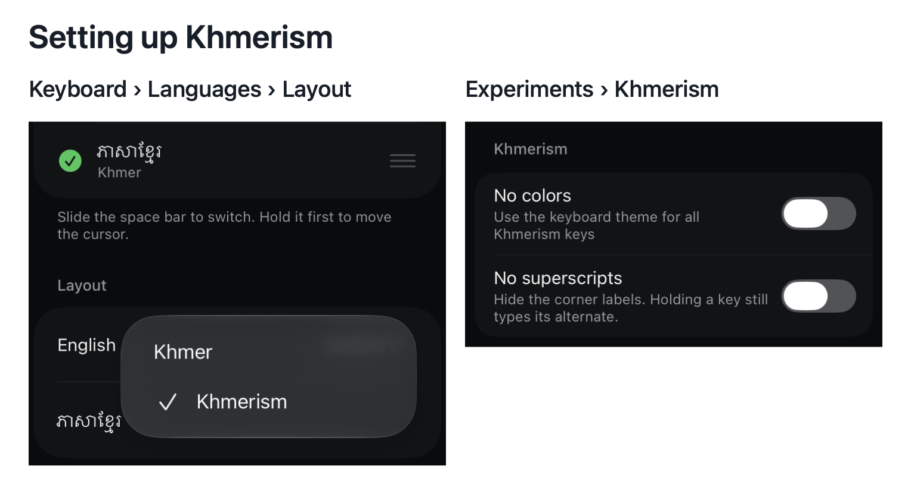

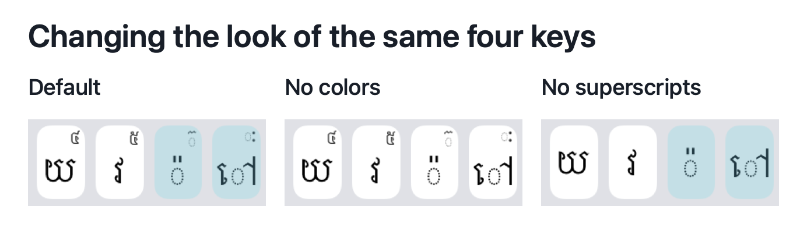

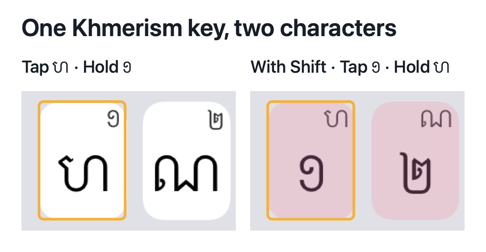

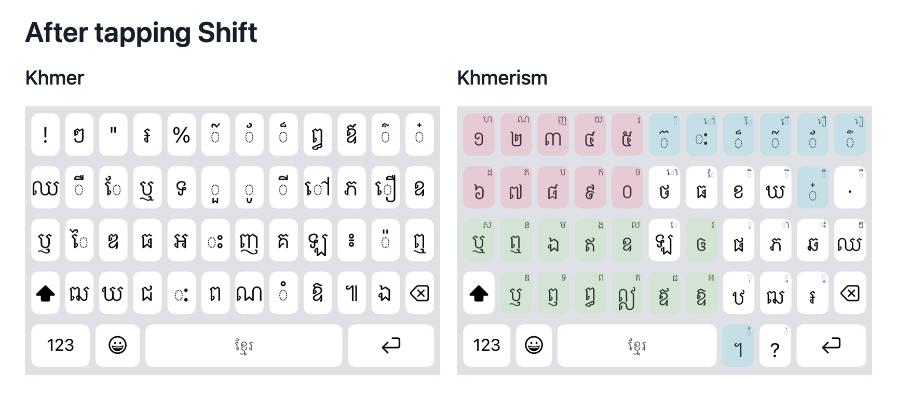

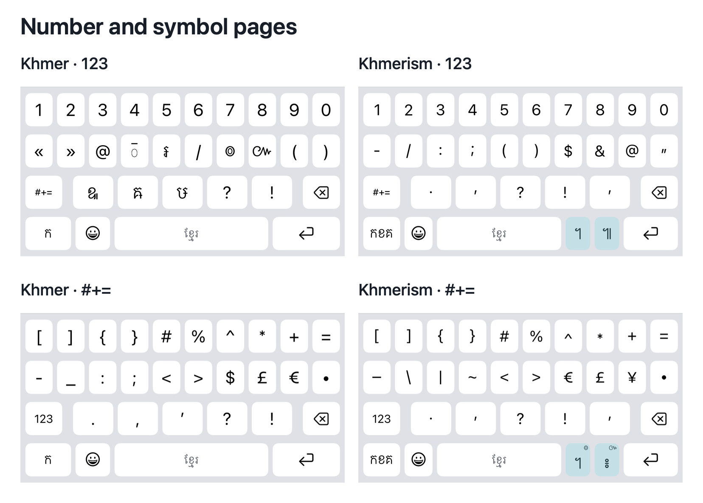

Word completion, smart typing and swipe examples

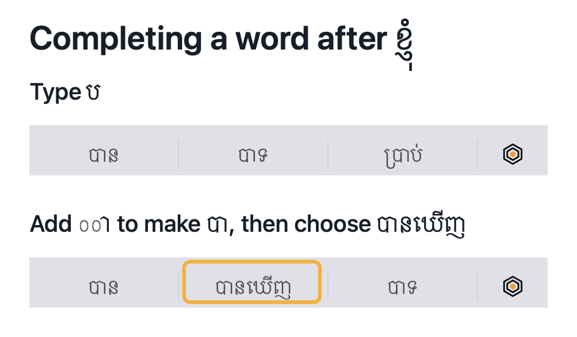

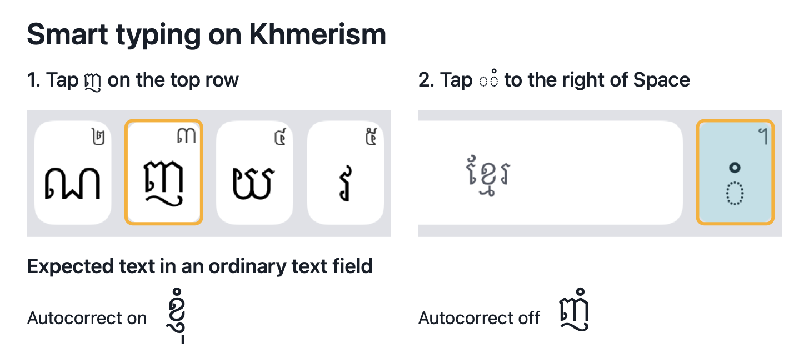

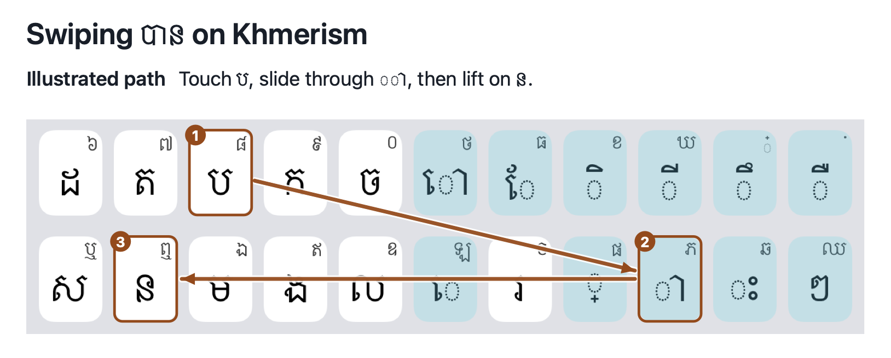

The screenshots come from an iOS simulator prototype. The swipe arrows illustrate the gesture, and the smart-typing figure shows the expected field text. The reference spec includes the full key maps, editing examples and data credits. The optional layout adapts Lyheng Phuoy’s Khmerism design. [Reference specification](https://github.com/SuuSoJeat/hex/blob/e6032500500467cd924d4af6222212dd0d35f030/ios/docs/khmer-keyboards.md) · [Khmerism Keyboard Project](https://solve.mit.edu/solutions/2452)

The full iOS Khmer keyboard implementation, including the layouts, typing models and tests, is available on the [reference implementation branch](https://github.com/SuuSoJeat/hex/tree/feature/ios-khmer-upstream).
